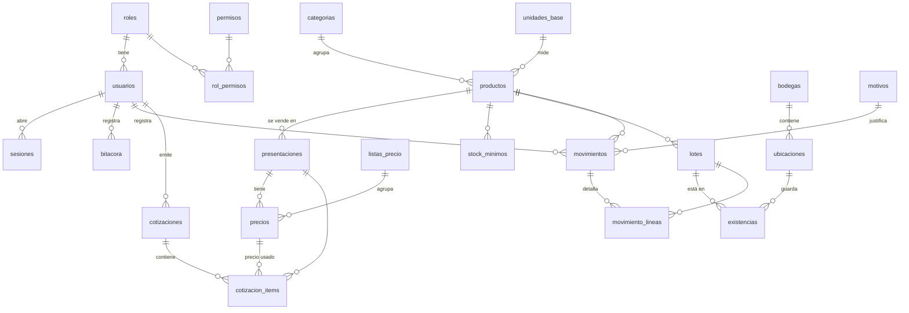

# Modelo de datos — Sistema de inventario Seúl Market

**Fase 2 · Borrador v1.** Diseño de la base de datos. **Todavía no está conectado a la aplicación**: la interfaz sigue usando los datos de demostración del navegador. La conexión se hace en las fases 4 y 5.

Archivos:

| Archivo | Contenido |
|---|---|
| [`db/esquema.sql`](../db/esquema.sql) | Tablas, restricciones, disparadores y vistas |
| [`db/datos-iniciales.sql`](../db/datos-iniciales.sql) | Configuración inicial: roles, unidades, listas de precio, reglas de vencimiento, bodegas y ubicaciones |

---

## 1. Principios

1. **El stock vive en un solo lugar:** la tabla `existencias`, por **lote y ubicación**, en unidades base enteras (unidad o gramo). Cajas y packs son equivalencias (`presentaciones.factor`).
2. **El stock solo cambia por movimientos.** Cada cambio queda en `movimientos` (quién, cuándo, qué) y `movimiento_lineas` (qué lote, desde dónde, hacia dónde).
3. **Nada se borra.**
   - Movimientos, bitácora, precios y cotizaciones no se pueden modificar ni borrar; lo impide la propia base de datos.
   - Un error se corrige con un contra-movimiento de anulación.
   - Un precio nuevo cierra el anterior.
   - Una cotización solo puede pasar a "anulada".
4. **Sin stock negativo:** `existencias.cantidad >= 0` y `reservada <= cantidad` son restricciones de la base de datos, no solo de la pantalla.
5. **Dinero en pesos enteros (CLP).**
6. **No se inventan datos de la empresa.** Lo que la empresa no ha entregado queda en `NULL` (pendiente) o marcado `provisional = 1`.
7. **Sin secretos en claro.** Se guarda el *hash* de la contraseña y el *hash* del token de sesión, nunca los valores reales. La bitácora no guarda contraseñas ni tokens.

---

## 2. Diagrama



---

## 3. Tablas

### Usuarios y acceso

| Tabla | Para qué | Reglas clave |
|---|---|---|
| `roles` | Perfiles: `dueno` y `vendedor_mayorista` | Se pueden agregar roles sin cambiar código |
| `permisos` | Catálogo de acciones (ej. `inventario.ver`) | El catálogo y la matriz se definen en la **Fase 3** |
| `rol_permisos` | Qué permisos tiene cada rol | — |
| `usuarios` | Una cuenta por persona | Correo único sin distinguir mayúsculas. `hash_contrasena` en NULL hasta que la persona define su clave. Contador de intentos fallidos y bloqueo temporal. Se desactivan, no se borran |
| `sesiones` | Sesiones abiertas | Guarda el hash del token, la expiración y el cierre o revocación |
| `bitacora` | Quién hizo qué y cuándo | Solo se agregan filas. `detalle` en JSON con el antes y el después |

### Empresa

| Tabla | Para qué | Reglas clave |
|---|---|---|
| `empresa_config` | Logo, colores, razón social, RUT, contacto, vigencia de cotización, IVA | Una sola fila. **Todo en NULL** hasta que la empresa lo entregue |
| `correlativos` | Numeración única (`COT-2026-000001`) | Se incrementa dentro de una transacción en la Fase 7 |

### Catálogo y precios

| Tabla | Para qué | Reglas clave |
|---|---|---|
| `categorias` | Agrupación de productos | — |
| `unidades_base` | `unidad` y `gramo` | Los productos caseros (kimchi, panceta) se llevan en gramos |
| `productos` | Ficha del producto | `sku` = código de barras **de la unidad**, único. `sku_es_interno` marca los creados por falta o error del código. `vida_util_meses` decide la regla de alerta. `habilitado_mayorista` lo publica en la lista mayorista |
| `presentaciones` | Unidad, pack o caja con su `factor` | Una sola presentación base, con factor 1. `codigo_barras` de la caja, único. `cotizable` decide si aparece en la lista mayorista |
| `listas_precio` | `B2C` y `MAYORISTA` | Separadas |
| `precios` | Precio por lista y presentación | Un solo precio vigente (`vigente_hasta` NULL) por lista y presentación. Para cambiarlo se cierra el vigente y se inserta uno nuevo, así queda el historial |

### Bodegas e inventario

| Tabla | Para qué | Reglas clave |
|---|---|---|
| `bodegas` | TF, A, B, C | Agrupan ubicaciones físicas |
| `ubicaciones` | TF0, TF1, A1, C1… | Se pueden agregar sin límite y desactivar. `canal` indica a qué inventario pertenece lo que está ahí. **Solo la sala de ventas (TF0) es B2C; todas las bodegas, incluidas TF1 y TF2, son B2B.** `provisional` marca los códigos por confirmar |
| `lotes` | Lote recibido de un producto | `fecha_vencimiento` es la **fecha real** y es obligatoria si el producto controla vencimiento. `codigo_proveedor` es opcional |
| `existencias` | Cantidad de un lote en una ubicación | Única por (lote, ubicación). `cantidad >= 0`, `0 <= reservada <= cantidad` |
| `stock_minimos` | Mínimo por producto, opcionalmente por bodega y canal | Una regla por combinación |

### Movimientos

| Tabla | Para qué | Reglas clave |
|---|---|---|
| `motivos` | Motivos de devolución, merma y ajuste | Quedan `provisional` hasta que la empresa defina la lista oficial |
| `movimientos` | Cabecera: tipo, fecha, usuario, producto, canal, motivo, referencia, presentación, cantidad ingresada, factor y unidades | Inmutable. Una venta exige canal. Una anulación apunta al movimiento que anula, y cada movimiento se anula una sola vez |
| `movimiento_lineas` | Detalle por lote: origen y/o destino y unidades | Solo origen = salida. Solo destino = entrada. Ambos = traslado, con origen distinto del destino |

Un **traslado** queda con producto, lote, origen, destino, cantidad, usuario y fecha, como pide la especificación.

### Vencimientos

| Tabla | Para qué | Reglas clave |
|---|---|---|
| `reglas_vencimiento` | Días de alerta según la vida útil | Se aplica la regla con el menor "hasta meses" que sea ≥ la vida útil del producto. La fila con NULL cubre más de 12 meses o vida útil sin informar |

| Vida útil | Alerta | Estado |
|---|---|---|
| hasta 6 meses | 30 días (1 mes) antes | Confirmado |
| hasta 12 meses | 50 días antes | Confirmado |
| más de 12 meses o sin dato | 50 días antes | Confirmado |

### Cotizaciones

| Tabla | Para qué | Reglas clave |
|---|---|---|
| `cotizaciones` | Número único, fecha, vendedor, cliente, vigencia, IVA, totales y estado | Copia los datos de la empresa y del IVA al emitir, para que no cambie después. **No reserva ni descuenta stock** y no tiene campos de inventario. Solo se puede anular |
| `cotizacion_items` | Líneas con producto, presentación, cantidad y precio usado | Copia el SKU, la descripción y el precio vigente en ese momento |

---

## 4. Vistas

| Vista | Qué entrega | Quién podrá usarla (se define en la Fase 3) |
|---|---|---|
| `vista_existencias` | Producto, lote, vencimiento, bodega, ubicación, cantidad, reservada y disponible | Solo usuarios con acceso al inventario |
| `vista_stock_producto` | Físico, reservado y disponible por producto y canal | Solo usuarios con acceso al inventario |
| `vista_alertas_vencimiento` | Producto, lote, cantidad, vencimiento, días restantes, días de alerta, bodega y ubicación | Solo usuarios con acceso al inventario |
| `vista_catalogo_mayorista` | Productos habilitados con su presentación y precio mayorista vigente | **Lo único del catálogo que verá el vendedor mayorista.** No tiene cantidades, lotes, bodegas ni ubicaciones |

**Las alertas se calculan al consultarlas; no se guardan.** Por eso no puede haber avisos duplicados. Si en el futuro se envían notificaciones (correo o mensajería, Fase 9), se agregará una tabla de notificaciones enviadas con una restricción única por lote, ubicación y umbral.

---

## 5. Reglas que aplicará el servidor (fases 4 a 7)

Algunas reglas dependen de varias tablas a la vez y se aplicarán en la lógica del servidor, dentro de una transacción:

- **Movimientos.**
  - La suma de `movimiento_lineas.unidades` debe ser igual a `movimientos.unidades`.
  - `unidades = cantidad_ingresada × factor` y debe ser un número entero.
  - El lote de cada línea debe pertenecer al producto del movimiento.
- **FEFO:** en salidas y ventas se sugieren primero los lotes que vencen antes y tienen stock. **No se permite vender lotes vencidos.**
- **Existencias:** solo se actualizan junto con su movimiento, y cada movimiento sensible se registra en la `bitacora`.
- **Precios y cotizaciones:**
  - Un cambio de precio cierra el vigente e inserta el nuevo en la misma transacción.
  - El número de cotización sale de `correlativos` dentro de la misma transacción.
- **Mayorista:** solo consulta `vista_catalogo_mayorista` y sus propias cotizaciones. Se aplica en el servidor (Fase 3).

---

## 6. Correspondencia con el prototipo actual

| Prototipo (navegador) | Modelo nuevo |
|---|---|
| `producto.stock[ubicación]` | Suma de `existencias` por ubicación |
| `producto.lotes[]` | `lotes` + `existencias` |
| Unidades "sin lote asignado" | Un lote técnico por producto y ubicación al migrar |
| `precioB2C`, `precioB2B` | `precios` en las listas `B2C` y `MAYORISTA`, sobre la presentación base |
| `reservado` por producto | `existencias.reservada` por lote y ubicación. Queda en 0 hasta implementar reservas |
| Ubicaciones `sala`, `bodega`, `refrigerador` | Solo para migrar la demo: `TF0` (B2C), `TF1` y `C1` (B2B) |
| `movimiento` con `lotes[]` | `movimientos` + `movimiento_lineas` |
| Sin usuarios | Cada movimiento exige `usuario_id` |

**Los datos de demostración no se migrarán a la base real.** La base real empezará con los conteos físicos iniciales (decisión de negocio 11). La correspondencia sirve para que la demo funcione sobre la base local en la Fase 4.

---

## 7. Supuestos y pendientes

**Supuestos (configurables):**

- **Ubicaciones provisionales:**
  - `TF0` es la sala de ventas.
  - `C1` es la ubicación general de la cámara de frío, porque toda existencia necesita una ubicación.
- **Pisos:** los de las ubicaciones de A y B quedan sin informar.
- **Precio vigente:** es el que no tiene fecha de término. No se programan precios futuros.
- **Cotizaciones por presentación:** se cotiza en presentaciones marcadas como `cotizable` y en cantidades enteras de esa presentación.
- **Reservas** (abono del 50% y 7 días): la columna existe, pero el flujo es una etapa futura. Una cotización nunca reserva.

**Pendiente de la empresa:**

- Logo, colores, razón social, RUT, dirección, teléfono, correo y sitio web.
- Vigencia de las cotizaciones y si los precios incluyen IVA.
- Nombre y correo de los 3 dueños.
- Confirmación de `TF0` y `C1`.
- Lista oficial de motivos de merma, ajuste y devolución. Por ahora no está definida.

**Confirmado por la empresa (2026-11-18):**

- **Canal por ubicación:** solo lo que está físicamente en la sala de ventas (packs o unidades sueltas) es inventario B2C. Todas las bodegas, incluidas TF1 y TF2, son inventario B2B. Pasar mercadería de una bodega a la sala es un traslado que cambia de canal (sale de B2B y entra a B2C).
- **Alertas:** 30 días (1 mes) para vida útil de hasta 6 meses y 50 días para vida útil de 1 año o más.

---

## 8. Cómo revisar el esquema

Con el SQLite que trae macOS, sin instalar nada. Esto crea una base temporal en memoria y no modifica ningún archivo:

```bash
cd "/Users/salo/Desktop/Seul Market - Sistema de Inventario"
```

```bash
sqlite3 :memory: ".read db/esquema.sql" ".read db/datos-iniciales.sql" ".tables"
```

Debe listar 24 tablas y 4 vistas.

**Portabilidad:** las tablas y vistas usan SQL estándar compatible con PostgreSQL. Los disparadores (`TRIGGER`) y algunas funciones de fecha (`julianday`, `strftime`) son propios de SQLite y se traducirán si en la Fase 9 se elige una base administrada.
